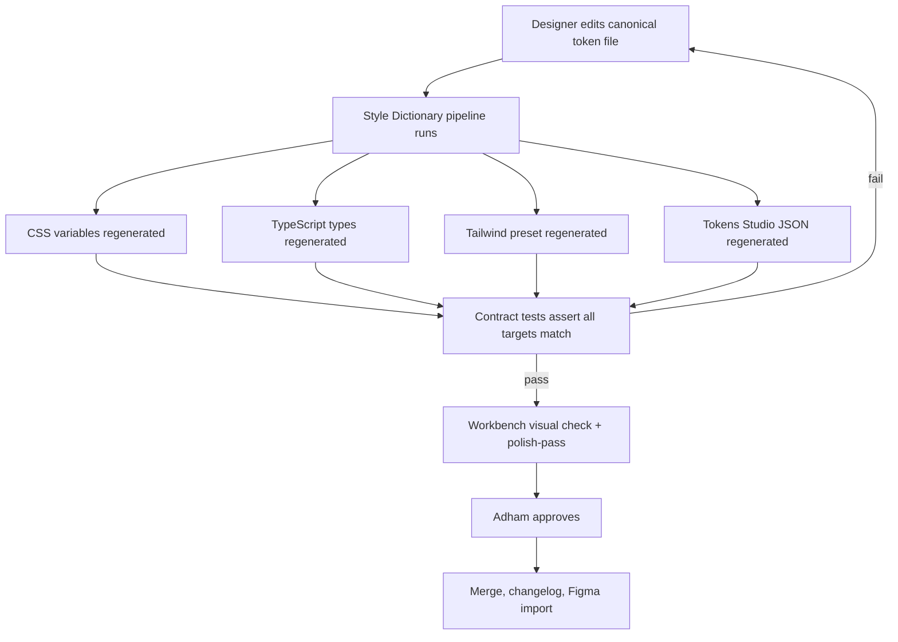
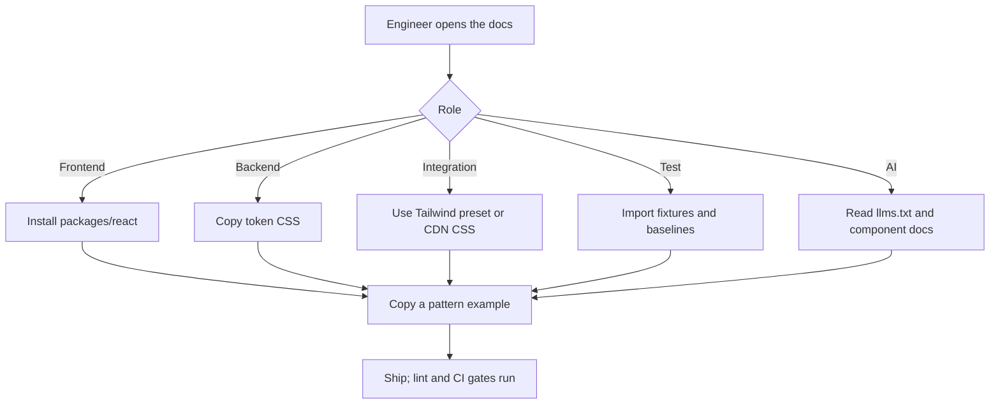

# SIS design system expansion - Product Requirements Document

Version 1.0, 2026-10-28. Owner: Adham Haitham Eid. Status: approved for M0.
Source research: [expansion source notes](../research/2026-10-28-design-system-expansion-sources.md).
Repository: https://github.com/Organization-name-temp/SIS-Product-Design

## 1. Background and goals

### 1.1 Background

The SIS design system holds approved foundations, an interactive workbench, and delivery records.
It is public and MIT licensed. Adham is the solo designer and the sole design approver.
The Modern SIS product (sis-docs) is a multi-tenant student information system: React web frontend, Laravel backend, AI assistant at R0.5, native mobile after R1.
Today the repository documents decisions. It does not yet ship consumable packages, production components, or governance.
Every upcoming surface depends on this system: dashboards, admin screens, landing pages, email, presentations, print, and mobile.

### 1.2 Goals

- Business goal: every SIS surface ships from one design source, so no team rebuilds foundations.
- User goal: an engineer of any role uses the system in minutes, without meeting the designer.
- Product goal: a token-first, multi-tenant, accessible component library with docs, gates, and governance.

### 1.3 Success metrics

| Metric | Definition | Target |
|---|---|---|
| Adoption rate | Share of new SIS UI built from the packages | 100 percent of new product screens after M4 |
| Detach rate | Share of consumers overriding token values | Under 5 percent of screens |
| Time to first screen | New engineer to a styled, accessible screen | Under one hour with docs alone |
| Consistency issues | Raw hex or pixel values in product PRs | Zero after enforcement flips to blocking |
| Accessibility | WCAG 2.2 AA findings on shipped components | Zero verified failures |
| AI-readiness | Machine-readable docs and stable APIs | llms.txt plus per-component docs at M5 |

## 2. Users

| Persona | Builds | Needs from the system |
|---|---|---|
| Adham, solo designer | Foundations, components, patterns, governance | One canonical source, gates that protect quality, low maintenance |
| Frontend engineer | SIS React web app | Typed React packages, copy-paste examples, RTL and density support |
| Backend engineer | Admin tools, transactional email | Token CSS without React, lint rules for any HTML they ship |
| Integration engineer | Client integrations, embeds | Tailwind preset, CDN-ready CSS, Tokens Studio JSON |
| Test engineer | Test plans and automation | Stable test IDs, a11y fixtures, visual baselines, recipes |
| AI engineer | AI assistant features (R0.5) | AI chat components, llms.txt, structured docs |

## 3. Core usage scenarios

1. Frontend engineer builds a registration form: installs `@scope/react`, copies the form example, ships with RTL and density handled.
2. Backend engineer ships a password-reset email: uses the token CSS and the email template (E13, backlog), passes the lint gate.
3. Test engineer writes a plan: imports a11y fixtures and visual baselines from the package, follows the recipes doc.
4. AI engineer builds a chat screen: uses the AI family components, reads llms.txt for structured APIs.
5. Designer approves a token change: edits the canonical file, the pipeline regenerates every target, contract tests verify, Figma imports the new JSON.
6. A second university (tenant) brands its SIS: maps its palette onto the semantic roles with the onboarding guide, no code changes.

## 4. User interaction flow

### 4.1 Token change flow

### 4.2 Consumer onboarding flow

Key experience nodes: the role entry pages are the onboarding step. The aha moment is a working, themed, accessible screen in under one hour. Retention comes from the gates catching drift before review.

## 5. Feature modules and boundaries

### 5.1 MVP (this expansion)

| Feature | Description | Priority |
|---|---|---|
| Token pipeline v2 | Style Dictionary v4 over canonical foundations; emits CSS, TS types, Tailwind preset, Tokens Studio JSON; contract tests | P0 |
| Multi-tenant theming | Swappable brand layer over stable semantic roles; tenant onboarding guide | P0 |
| Component packages | `sis-tokens`, `sis-react`, `sis-tailwind-preset` on npm workspaces; React 19 + TypeScript; hand-rolled keyboard, focus, and ARIA behaviors, no primitive library (grilling round one) | P0 |
| Pilot families | Buttons, text fields, badges, selection controls, dialog; full state and RTL × theme × density matrices | P0 |
| Dashboards and admin patterns | KPI cards, filter bars, data-table pages, settings forms, empty, error, loading states | P0 |
| Docs in the workbench | Role entry pages, API reference, maturity labels, copy-paste examples | P0 |
| Test kit | Test ID conventions, a11y fixtures, visual baselines, testing recipes | P1 |
| AI surface | llms.txt, structured component docs, AI chat family (chat panel, messages, citations, streaming states) | P1 |
| Gradual enforcement | Stylelint and ESLint token rules as warnings, CI-blocking after the pilot | P1 |
| Figma tokens bridge | Tokens Studio JSON plus import guide; verified against the modes CSV | P1 |
| Governance | Changesets, GitHub Actions CI, contribution guide, code of conduct, ADRs, maturity model | P1 |

### 5.2 Future iterations (named backlog epics)

| Feature | Epic | Note |
|---|---|---|
| Landing and marketing kit | E12 | Templates for program pages and campaigns |
| Transactional email templates | E13 | Token-driven, MJML base, for backend engineers |
| Presentation and print profiles | E14 | Extends existing E08; HTML decks plus print and PDF |
| Tenant brand onboarding kit | E15 | Guided workflow for each new university brand |
| Mobile packages | E16 | After the R1 mobile decision; neutral tokens already emit the right formats |
| Figma component library | KAN-217 | After code components stabilize |

### 5.3 Explicitly not doing

- Svelte or Vue packages: no confirmed consumer; React covers the product stack.
- npm publish before the org rename: publishing under a placeholder scope creates permanent public names.
- Figma component library now: variables first, components after the code API stabilizes.
- Production SIS services or university policy: out of scope for a design system repo.

## 6. Product form and constraints

### 6.1 Platform

npm packages consumed by React web apps and any stack that reads CSS variables. The workbench is the docs site. Figma receives generated variable files. Mobile receives neutral token exports later.

### 6.2 Technical constraints

- Node.js 24, npm workspaces, TypeScript strict.
- React 19. Behavior is hand-rolled per component (keyboard, focus, ARIA); no primitive library (grilling round one). An ADR records the pattern and the shared behavior hooks.
- Package names carry no npm scope until the org rename lands (grilling round one).
- Styling: plain CSS on token variables inside packages; zero runtime styling dependencies; optional Tailwind v4 preset.
- Canonical tokens stay in `foundations/`; everything else is generated and contract-tested.
- RTL: logical properties only; every component tests in RTL and LTR.
- Digits: international 0-9 in Arabic and English (D09).

### 6.3 Design principles

1. Tokens decide. No raw values in product code.
2. Behavior from primitives; skin from tokens.
3. The approved brand wins over agent taste. E-JUST red #EA232B, IBM Plex, formal, friendly, practical (D02).
4. Accessibility is the floor: WCAG 2.2 AA, keyboard first, 44px targets.
5. The gates run before delivery: interaction-states-pass, ai-slop-check, hierarchy-rhythm-review, polish-pass.
6. The system is a product: versioned, changelogged, maturity-labeled, governed.

## 7. Milestones

| Milestone | Deliverable |
|---|---|
| M0 | Skills installed, PRD approved, grilling round closed |
| M1 | Research synthesis, direction variations, direction pick |
| M2 | Token pipeline v2, multi-tenant brand layer, Figma bridge, contract tests |
| M3 | Pilot component families with full gates |
| M4 | All families, dashboards and admin patterns, enforcement blocking, test kit |
| M5 | Docs site upgrade, AI surface, governance, CI, release readiness |
| M6 | Jira epics E11 to E16, delivery report, records update |

## 8. Risks

| Risk | Mitigation |
|---|---|
| Org name is temporary | npm scope isolated in one config; publish gated |
| Untitled UI Figma file unverified | Not a dependency; imports use SIS-generated files |
| Solo capacity | Pilot sized to one sustained session; batches ship independently |
| React Aria learning curve | ADR records the choice; pilot validates before M4 scale-up |
| Enforcement flip breaks builds | Warnings first; flip only after pilot proves token coverage |

## Appendix

### A. Glossary

See [GLOSSARY.md](../../GLOSSARY.md). Terms of record: foundation, canonical source, token layers, profile, design record, density.

### B. References

The seven sources and their contributions: [source research](../research/2026-10-28-design-system-expansion-sources.md).

### C. Version history

| Version | Date | Change |
|---|---|---|
| 1.0 | 2026-10-28 | First approved version after grilling rounds one and two. |
