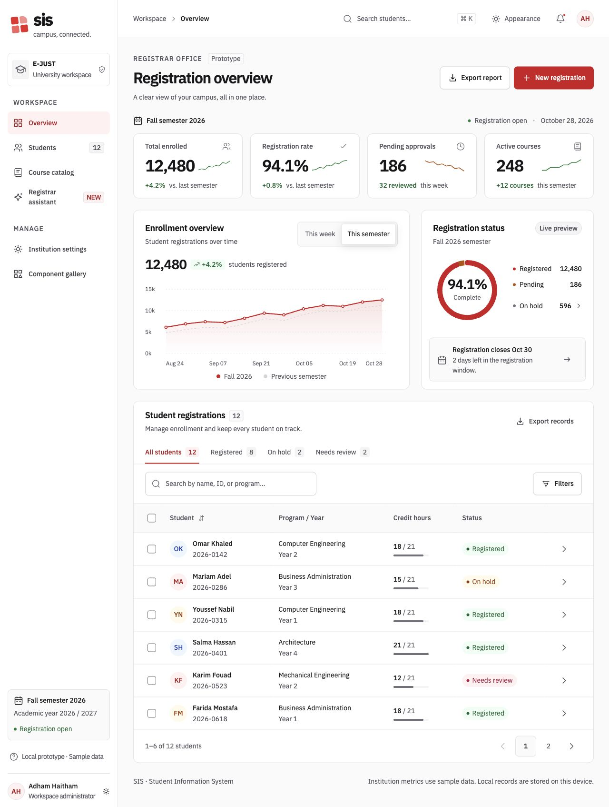

# Registrar prototype review

The revised [local prototype](http://localhost:4680) expands the original four-page demo into a six-page registrar workspace.
Adham requested this correction on October 28, 2026. Personal visual acceptance remains pending.

## Interface changes

The interface retains the approved IBM Plex font, E-JUST brand tokens, and Soft elevation direction.
A persistent sidebar and mobile navigation drawer replace the horizontal page tabs.
The dashboard has separate metric cards, an enrollment chart, a status summary, and a student table.
The interface uses logical CSS properties for both directions.

The [dark preview](assets/showcase-2026-10-28/overview-dark.png) and [mobile preview](assets/showcase-2026-10-28/overview-mobile.png) show the same workspace.

## Prototype behavior

| Page | Local behavior |
|---|---|
| Overview | Change the chart period, open held records, inspect the deadline, export records |
| Students | Search, filter, sort, select, paginate, inspect, export, and create records |
| Course catalog | Search courses, filter available seats, and inspect course details |
| Registrar assistant | Read local record summaries and open cited pages |
| Institution settings | Save office details, dates, credit limits, and notification preferences |
| Component gallery | Inspect component states and open an example dialog |

New student records and settings persist on the same device.
Saved dates and credit limits update the workspace and registration form.
Appearance settings persist after reload.

## Technical evidence

All results below refer to the local checkout on October 28, 2026.

| Check | Result | Evidence |
|---|---|---|
| Prototype unit checks | 11 passed | [Interaction and accessibility tests](../../apps/showcase/tests/app.test.tsx) |
| Prototype browser checks | 23 passed | [Browser tests](../../apps/showcase/tests/browser/workspace.spec.ts) |
| Prototype visual comparisons | Passed without baseline replacement | [New prototype baselines](../../apps/showcase/tests/browser/workspace.spec.ts-snapshots/) |
| Component unit checks | 89 passed | [Component tests](../../packages/react/tests/) |
| Existing component visual comparisons | 16 passed | [Visual suite](../../packages/react/tests/visual/visual.spec.ts) |
| Token checks | 4 passed | [Token tests](../../packages/sis-tokens/test/) |
| Prototype types and production build | Passed | [Commands](../../apps/showcase/package.json) |
| Component types and lint | Passed, with two existing lint warnings | [Commands](../../packages/react/package.json) |
| Workbench verify | Passed | [Workbench commands](../../sis-foundations-prototype/package.json) |

The new prototype baselines cover light and dark themes, both directions, and both densities.
Responsive comparisons cover 360px and 834px widths.
The browser checks scan every page in light and dark themes.
The checks also inspect focus return, device persistence, CSV content, course filters, and local assistant replies.

The expanded checks found two shared accessibility problems.
Switches now expose explicit state attributes. Loading buttons retain their accessible names.
The token builder now excludes metadata properties and misplaced CSS imports. The production CSS build has no warnings.

## Limits

Institution metrics and course availability use sample data. New local records do not change institution metrics.
The assistant uses local rules. It does not connect to an AI service or a university service.
The preview date remains October 28, 2026.
Direction controls change the layout. English content remains English in both directions.
Automated accessibility checks do not replace a screen-reader review.
The new visual baselines record this implementation. They do not establish design approval.

Adham remains the sole design approver.
