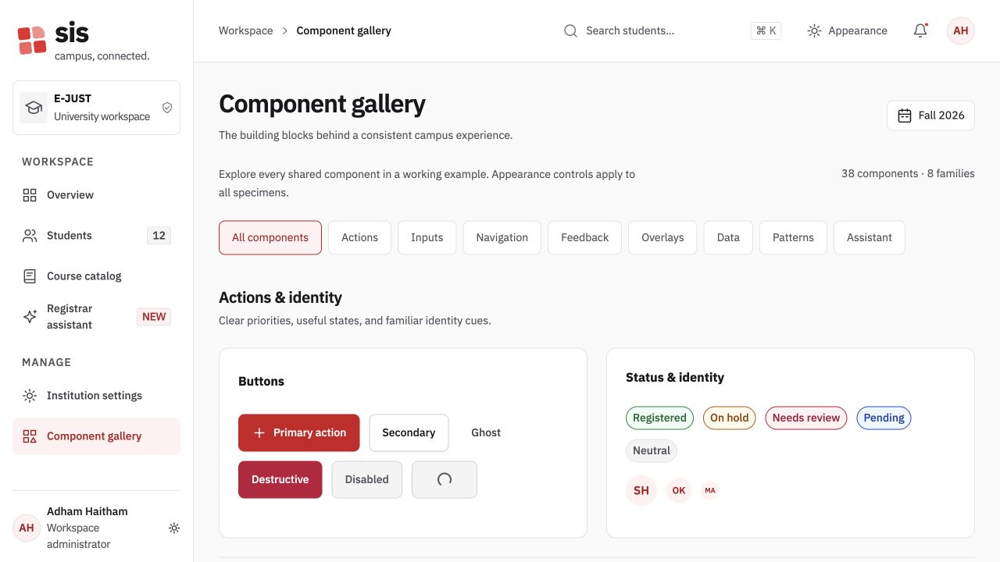
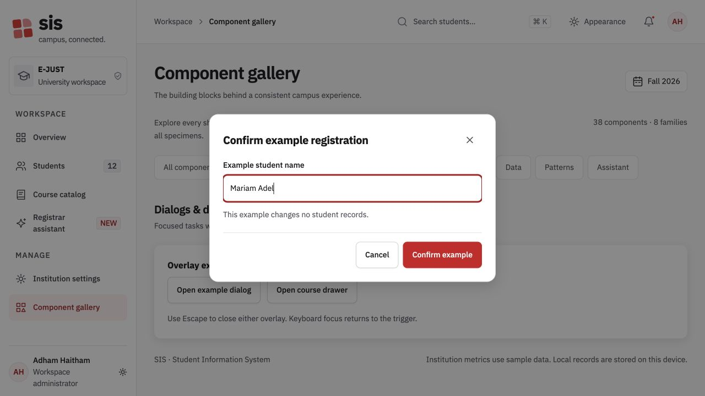

# SIS interface and component review

Date: October 29, 2026.

The local prototype now includes six complete pages and a gallery for all 38 public components.
This review extends the [October 28 review](2026-10-28-registrar-prototype.md).
Adham remains the sole design approver. These changes await personal visual acceptance.

## Interface changes

- The gallery includes eight component families, interactive filters, file uploads, menus, dialogs, drawers, charts, tables, and assistant examples.
- Controls use consistent spacing, token corners, visible focus, and larger targets.
- Charts use larger labels and accessible value descriptions. Narrow charts support keyboard scrolling.
- Pages support 320px layouts and 200% text scaling without document overflow.
- Dialogs and drawers contain keyboard focus, close with Escape, and restore focus to their triggers.
- Nested overlays preserve background isolation and restore page scrolling after closure.
- Tables support named scroll regions, sorting, selection, and clear empty states.
- Workbench controls and disclosure triggers use full touch targets. Navigation variants expose distinct landmark names.

## Shared behavior

The [component tests](../../packages/react/tests/) cover menu keys, RTL tabs, nested overlay teardown, upload validation, numeric limits, image fallback, and progress announcements.
FilterBar supports controlled search. SettingsForm supports cancellation and native reset.
PageHeader supports composed heading levels. Internal citations retain the current browser tab.
The [component API reference](../ai/sis-react.md) describes these changes.

## Token and screenshot corrections

The old component fixture referenced a missing token stylesheet. Its screenshots showed unstyled components.
The [corrected fixture](../../packages/react/visual/main.tsx) imports the real token bundle, component styles, and local IBM Plex fonts.
The new browser checks assert resolved tokens and actual control dimensions.
All 16 component screenshots now record the styled fixture across both themes, directions, and densities.
These screenshots replace the earlier fixture evidence. They do not establish design approval.

The token builder now emits canonical radius, opacity, and layer roles.
A missing layer export previously allowed the sidebar to appear above the dialog backdrop.
The builder also emits the standard easing alias from the canonical action recipe.
The new token checks reject unresolved component variables and token metadata in generated targets.
The pill corner now has a canonical DTCG token.

## Verification

| Check | Result | Reproducible source |
|---|---|---|
| Shared component unit checks | 103 passed | [Component tests](../../packages/react/tests/) |
| Showcase unit checks | 11 passed | [Showcase tests](../../apps/showcase/tests/app.test.tsx) |
| Showcase browser checks | 39 passed | [Website suite](../../apps/showcase/tests/browser/workspace.spec.ts) |
| Component browser checks | 26 passed | [Visual and behavior suites](../../packages/react/tests/visual/) |
| Token checks | 7 passed | [Token tests](../../packages/sis-tokens/test/) |
| Workbench browser checks | 92 passed | [Workbench suites](../../sis-foundations-prototype/tests/browser/) |
| Shared types and lint | Passed | [Component commands](../../packages/react/package.json) |
| Showcase types and build | Passed | [Showcase commands](../../apps/showcase/package.json) |
| Workbench verify | Passed | [Workbench commands](../../sis-foundations-prototype/package.json) |

The [system audit](../../apps/showcase/scripts/audit-system.mjs) inspected 325 configurations.
The configurations include all showcase pages, component fixtures, workbench specimens, five documentation tabs, and three review pages.
The audit also covers narrow layouts and theme, direction, and density combinations.

The [full audit summary](assets/system-2026-10-29/full-audit-summary.json) records zero JavaScript errors, zero document overflow, and zero missing token values.
That run found one duplicate-landmark issue in the navigation variants.
The implementation now adds distinct variant names to those landmarks.
The [focused audit](assets/system-2026-10-29/navigation-retest.json) covers seven navigation configurations and reports no violations, overflow, missing tokens, or small targets.
The full audit summary retains the original finding for traceability.

The screenshot comparisons use Chromium on macOS.
Comparison tolerances are 1% for showcase pages and 2% for component fixtures.
The [CI configuration](../../.github/workflows/ci.yml) now runs matching component and showcase jobs on each push.
This review records local results. It does not claim a completed remote CI run.

## Limits

Automated scans and screenshot comparisons do not prove that every pixel meets personal design expectations.
Manual screen-reader review and other browser engines remain outside this review.
Target inventories include hidden inputs and visual indicators. Their enclosing labels can provide larger interaction areas.
The prototype uses sample data and local storage. The assistant uses local rules.
English content remains English in RTL mode. The preview date remains October 28, 2026.
Figma synchronization and production service integration remain separate work.
